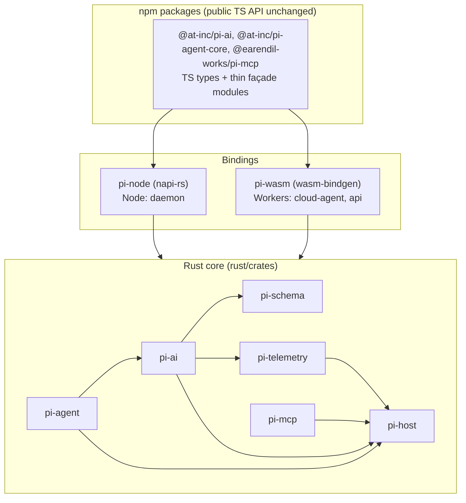

# Porting pi to Rust

This document is the contract for porting the pi TypeScript packages that bro-components depends on to Rust.
Every implementer and every reviewer reads it in full before touching a file. When a rule here conflicts with
your instinct for idiomatic Rust, the rule wins: the goal of this phase is a port that behaves exactly like the
TypeScript and reads like it was transpiled from it. Idiomatic cleanup comes after the port passes the tests.

The approach follows Bun's Zig-to-Rust rewrite (https://bun.com/blog/bun-in-rust): one porting guide, a
mechanical file-for-file port, an implementer plus adversarial reviewers in separate contexts for every file, and a
language-independent test suite (pi's vitest suites, run against the Rust core through the bindings) as the
final oracle.

## Scope

| TypeScript package | Path | Rust crate | Consumers in bro-components |
| --- | --- | --- | --- |
| `@earendil-works/pi-telemetry` | `packages/telemetry` | `pi-telemetry` | via pi-ai |
| `@earendil-works/pi-schema` | `packages/schema` | `pi-schema` | `Type` builders (re-exported by pi-ai) |
| `@at-inc/pi-ai` | `packages/ai` | `pi-ai` | daemon, cloud-agent, api, agent-manager (types), ui (types) |
| `@at-inc/pi-agent-core` | `packages/agent` | `pi-agent` | daemon, cloud-agent, agent-manager (types), common |
| `@earendil-works/pi-mcp` | `packages/mcp` | `pi-mcp` | daemon |
| (new) | - | `pi-host` | platform layer for all of the above |

`rust/PORT_MANIFEST.tsv` lists every TypeScript source file, the Rust file it maps to, its shard, and its status.

## Architecture

- The Rust core performs no I/O directly. All platform access goes through `pi-host`: `fetch`, `Date.now()`,
  `performance.now()`, `process.env`, timers, fire-and-forget tasks. The Node binding supplies these from Node,
  the wasm binding from the Workers runtime, the `native` feature from tokio/reqwest, and `pi_host::testing`
  from a scripted test host. This is what lets one core run in both the daemon and Cloudflare Workers.
- The core is single-threaded, like the JavaScript event loop it replaces: `Rc`, `RefCell`, `!Send` futures.
- Callbacks that the TypeScript API accepts (`AgentTool.execute`, `beforeToolCall`, `onPayload`, `fetch`,
  `convertToLlm`, ...) are Rust closures in the core and JavaScript functions behind the bindings.
- Bindings and the TS façade are a later phase (see "Phases"). Do not write binding code while porting.

## Files and modules

- One TypeScript file becomes one Rust file. The path is mechanical: kebab-case and dots become snake_case
  (`api/openai-codex-responses.ts` -> `api/openai_codex_responses.rs`, `providers/openai.models.ts` ->
  `providers/openai_models.rs`). `index.ts` becomes `lib.rs` or `mod.rs`. `compat.ts` became
  `compat/mod.rs` because a `compat/` directory exists. The skeleton already contains every file and every
  `pub mod` line; never add, remove, or rename modules without updating the manifest in the same commit.
- Each Rust file starts with `//! Port of \`<ts path>\`.` and a `//! PORT-STATUS:` line: `pending`,
  `ported`, or `reviewed` (after the adversarial review fixes are applied). Update the manifest status too.
- Keep the TypeScript order of declarations inside the file, so a reviewer can read both side by side.
- Keep TS doc comments as `///` doc comments, adjusted only where Rust types differ. Do not add new comments
  that narrate code.
- Re-exports: `export * from "./x.ts"` in an index becomes `pub use x::*;`. Named re-exports become `pub use`.
- A module named like a crate (`regex`, `url`, `uuid`, `time` in pi-schema) shadows it: refer to the crate
  as `::regex::Regex`.
- New Rust-only files (no TS counterpart) are allowed only where this guide names them (pi-host, SDK
  replacements in "Provider SDKs") and must be listed in the manifest with `ts_file` = `(new)`.

## Names

- Functions, methods, fields, locals: TS camelCase -> Rust snake_case (`normalizeContext` ->
  `normalize_context`, `getBuiltinModel` -> `get_builtin_model`). Types keep their TS name
  (`AssistantMessage`). Constants keep SCREAMING_CASE (`ANTHROPIC_MODELS`). Because the mapping is
  deterministic, you may call a function from a file another shard is porting by its predicted name and path;
  list such calls in your report so the compile-fix pass can reconcile them.
- Serialized field names never change: every serialized struct uses `#[serde(rename_all = "camelCase")]`
  and per-field `#[serde(rename = "...")]` where the TS name is not camelCase (`snake_case` wire fields of
  provider payloads, `$ref`, `type`).
- A TS type alias of a string-literal union (`StopReason`) becomes an enum with `#[serde(rename = "...")]`
  per variant, deriving `Clone, Copy, Debug, PartialEq, Eq, Hash, Serialize, Deserialize`.
- Open string unions (`Api = KnownApi | (string & {})`, `ProviderId`, `ImageApi`) become a transparent
  newtype `pub struct Api(pub String)` with `#[serde(transparent)]`, `From<&str>`, and `Deref<Target = str>`.
  Known values are `pub const` strings in a submodule named after the type (`api::ANTHROPIC_MESSAGES`).

## Types

| TypeScript | Rust |
| --- | --- |
| `number` in a serialized type | `f64`. Always. (JSON output goes through `pi_host::js::json_stringify`, which prints `1`, not `1.0`.) |
| `number` used only as a local index or count | `usize` / `i64` as natural; convert at the boundary. |
| `string` | `String` (owned in structs), `&str` in parameters |
| `boolean` | `bool` |
| `x?: T` | `Option<T>` with `#[serde(default, skip_serializing_if = "Option::is_none")]` |
| `x: T \| null` | `Option<T>` serialized as `null` (no skip) |
| `x?: T \| null` | `Option<Option<T>>` with `serde_with`-style double option (`#[serde(default, deserialize_with = "pi_host::js::double_option")]`) only where the distinction is observable; otherwise `Option<T>` |
| `unknown`, `any`, `JsonValue` | `serde_json::Value` |
| `JsonObject`, `Record<string, unknown>` | `serde_json::Map<String, Value>` (`preserve_order` is enabled workspace-wide) |
| `Record<string, T>` | `IndexMap<String, T>` (insertion order, like JS objects) |
| `T[]`, `readonly T[]` | `Vec<T>` (owned), `&[T]` in parameters |
| `Set<T>` / `Map<K, V>` | `IndexSet` / `IndexMap` (JS iteration order is insertion order) |
| tagged union on `type` / `role` / `kind` | `#[serde(tag = "type")] enum` with `#[serde(rename = "...")]` variants |
| untagged union (`string \| TextContent[]`) | `#[serde(untagged)] enum` with variants in the TS order |
| interface with methods / class | `struct` + `impl`; `#private` fields stay private |
| `interface X extends Y` | `struct X { #[serde(flatten)] base: Y, ... }` only for serialized types; for option bags, repeat the fields (see "Option bags") |
| `Promise<T>` | `async fn` returning `T`, or `LocalBoxFuture<'static, T>` when stored |
| function-typed field / callback parameter | `Rc<dyn Fn(A, B) -> LocalBoxFuture<'static, R>>` (async) or `Rc<dyn Fn(A) -> R>` (sync); define one named `type` alias per TS callback type |
| `AbortSignal` | `pi_host::AbortSignal` (`Option<AbortSignal>` for `signal?:`) |
| `typeof fetch` | `pi_host::FetchFunction` |
| `Error` / `throw` | `pi_host::PiError` / `return Err(...)`; functions that can throw return `PiResult<T>` |
| `Date.now()` | `pi_host::now_ms()` (`f64`) |
| `performance.now()` | `pi_host::monotonic_ms()` |
| `process.env.X` | `pi_host::env("X")` |
| `setTimeout` promise / pi-ai `sleep` | `pi_host::sleep(ms, signal).await` |
| `void someAsync()` | `pi_host::spawn_local(async move { ... })` |
| `async function*` | `pi_host::sse::async_stream` or an explicit `futures::Stream` |
| `for await (const x of stream)` | `while let Some(x) = stream.next().await` |
| `EventStream<T, R>` | `pi_ai::utils::event_stream::EventStream<T, R>` (already ported; use it, do not re-implement) |

Generic TS types whose type parameter only narrows a field (`Model<TApi>`, `ToolResultMessage<TDetails>`,
`AgentTool<TParameters, TDetails>`) become one non-generic Rust type with the widest field type. Conditional
types (`Model.compat`) become the raw JSON value plus typed accessors:
`compat: Option<serde_json::Map<String, Value>>` and `fn openai_completions_compat(&self) -> OpenAICompletionsCompat`
that deserializes on demand. Type-level helpers with no runtime effect (`IsJsonCompatible`, `JsonRepresentation`,
`Static<T>`) are dropped; note them in the file header.

### The message and event model

These definitions are fixed; the pi-ai types shard implements them exactly.

- `Message` is `#[serde(tag = "role")]` over `System(SystemMessage)`, `User(UserMessage)`,
  `Assistant(AssistantMessage)`, `ToolResult(ToolResultMessage)` with roles `system`, `user`, `assistant`,
  `toolResult`.
- Content blocks are `#[serde(tag = "type")]` enums. `AssistantContent` = `Text | Thinking | ToolCall`,
  `UserContent` = `Text | Image`. Each block is its own struct (`TextContent`, `ThinkingContent`,
  `ImageContent`, `ToolCall`) so functions can take one block type.
- `pub type SharedAssistantMessage = Rc<RefCell<AssistantMessage>>;` In TypeScript every event's `partial` is
  the same live object that the provider mutates. The Rust port keeps that: providers own one
  `SharedAssistantMessage` and put clones of the `Rc` into events. `AssistantMessageEvent` variants:
  `Start { partial }`, `TextStart { content_index, partial }`, `TextDelta { content_index, delta, partial }`,
  `TextEnd { content_index, content, partial }`, the same three for `Thinking`, `ToolcallStart`,
  `ToolcallDelta`, `ToolcallEnd { content_index, tool_call, partial }`, `Done { reason, message }`,
  `Error { reason, error }`, where `partial`, `message`, and `error` are `SharedAssistantMessage` and
  `content_index` is `usize`. Serialization borrows the message. Never hold a `borrow()` or `borrow_mut()`
  across an `.await` (clippy denies it workspace-wide).
- `AgentMessage` (pi-agent) is `enum AgentMessage { Llm(Message), Custom(serde_json::Value) }` with a manual
  `Deserialize` that picks `Llm` for the four known roles and `Custom` otherwise, and an untagged
  `Serialize`. This replaces TypeScript declaration merging (`CustomAgentMessages`): apps' custom messages
  pass through the core untouched.

### Option bags

Option interfaces (`StreamOptions`, `SimpleStreamOptions`, `AnthropicOptions`, `AgentLoopConfig`) carry
callbacks and are not serialized. Port them as plain structs with `Default`, `Option<...>` fields, and
`Clone` (callbacks are `Rc`). For `interface B extends A`, give `B` a field `pub base: A` and implement
`Deref<Target = A>` / `DerefMut` so `options.signal` keeps reading naturally. TS's `ProviderStreamOptions =
StreamOptions & Record<string, unknown>` becomes `StreamOptions` plus `pub extra: serde_json::Map<String, Value>`.

## Behavior that must match byte for byte

- **JSON output**: always `pi_host::js::json_stringify` / `json_stringify_pretty`, never
  `serde_json::to_string`, for anything that leaves the process or is compared in tests: request bodies, tool
  call argument strings, signatures, cache keys, error messages that embed JSON.
- **Object key order**: JS emits keys in insertion order. Build provider payloads with `serde_json::json!` or
  `Map::insert` in exactly the order the TS object literal and its later mutations produce them, including keys
  added conditionally (`if (x) params.foo = x`). A spread `{ ...a, b }` inserts `a`'s keys first, then
  overwrites or appends `b` (overwriting keeps the original position).
- **`undefined` vs absent**: `JSON.stringify` drops `undefined` properties. A TS literal `{ a: maybeUndefined }`
  therefore becomes a conditional insert.
- **String lengths and slicing** use UTF-16 code units wherever the result is observable (token estimates,
  truncation, offsets): `pi_host::js::utf16_len`, `utf16_prefix`.
- **Number formatting** in strings: `pi_host::js::number_to_string` (JS `String(n)`), never `format!("{}", f64)`.
- **Truthiness**: `if (str)` is false for `""`; `if (n)` is false for `0` and `NaN`; `x ?? y` only replaces
  `null`/`undefined`; `x || y` also replaces `""`, `0`, `false`. Port each operator exactly.
- **Regex**: `regex` crate; use `fancy_regex` only when the TS pattern needs lookaround or backreferences. JS
  `\s`, `\w`, `\d` and case-insensitive flags differ slightly from Rust's Unicode defaults: use `(?-u:\w)`
  style ASCII classes when the TS regex has no `u` flag and the input can contain non-ASCII.
- **Error messages**: copy TS message strings exactly, including template-literal formatting.
- **Timestamps** come from `pi_host::now_ms()` at the same point in control flow as the TS `Date.now()` call.

## Provider SDKs

pi-ai uses `@anthropic-ai/sdk`, `openai`, `@google/genai`, `@aws-sdk/client-bedrock-runtime`, and
`partial-json`. Rust has no equivalent official SDKs, so each API shard adds one Rust-only client file next to
the API file (`api/anthropic_client.rs`, `api/openai_client.rs`, `api/google_client.rs`,
`api/bedrock_client.rs`) that reproduces exactly the SDK behavior pi-ai relies on and that tests can observe:
URL construction, default headers (including `x-stainless-*` / version headers the SDK sends), auth headers,
timeouts, retry policy and backoff (including `retry-after` and `x-should-retry` handling), error-body
parsing into the SDK's error message format, and SSE decoding via `pi_host::sse`. Read the SDK source in
`node_modules` to get these right; do not guess. Bedrock uses `aws-sigv4` for signing and
`aws-smithy-eventstream` for the binary event stream. `partial-json` is ported inside
`utils/streaming_json.rs`.

## Async, ownership, and lifetimes

- No lifetimes in public types: owned `String`/`Vec`, `Rc` for shared objects. A TS object that several
  places hold and mutate becomes `Rc<RefCell<T>>`; an object passed down and only read becomes `&T` or a clone.
- TS code that mutates a parameter in place (`message.content.push(...)`) takes `&mut T`.
- Futures are `!Send`; never require `Send` or `Sync`. Never block: no `block_on` outside tests.
- No `unsafe` (denied workspace-wide). No `unwrap()`/`expect()` on values that come from the network, the user,
  or JSON; map them to the same error the TS would throw. `expect` is fine for invariants the TS also assumes
  (`!` non-null assertions), with the TS reasoning as the message.

## Tests

- Port every non-e2e vitest file of the crate to `rust/crates/<crate>/tests/<name>.rs` (kebab -> snake,
  `.test` dropped): same `describe` grouping as modules, same `it` names as `#[test] fn` names, same assertions.
  e2e files (they need real API keys or network) are not ported; mark them `e2e` in the manifest.
- Tests that stub `globalThis.fetch` or use fake timers use `pi_host::testing::run` and `TestHost`. Tests that
  `vi.mock` an SDK module instead mock at the HTTP level through `TestHost`, asserting the same observable
  payloads and results.
- `cargo test -p <crate>` and `cargo clippy -p <crate> --all-targets -- -D warnings` must pass for the files your
  shard owns before you report. Calls into files other shards still port may not compile yet; isolate them so
  the rest of your crate compiles (see "Cross-shard calls").

## Cross-shard calls

When your file calls a function owned by a file another shard ports in the same wave and that file is still
`pending`, add the item to that file under a `// PORT-STUB: <shard>` comment with the predicted signature and a
body of `todo!("PORT-STUB")`, and list it in your report. The owning shard replaces the stub. Never stub
something in a file that is already `ported`: call what is there or report the mismatch.

## Workflow per shard

1. Read this document, the manifest rows of your shard, and every TS file of your shard in full, plus the TS
   tests that cover them.
2. Port the files in dependency order. Commit per file or small group, staging explicit paths only.
3. For each file group, start two adversarial reviewer subagents on your machine (`machine: "shared"`). Give
   each only: this document's path, the TS file paths, the Rust file paths, and this instruction: "Assume the
   port is wrong. Find every behavioral difference from the TypeScript: control flow, error paths and messages,
   JSON key order and number formatting, truthiness, UTF-16 lengths, async ordering and cancellation, missing
   branches, SDK behavior. Report each with file:line and a concrete input that shows the difference. Do not edit
   files." Reviewers never implement; you never dismiss a finding without a concrete reason.
4. Apply the findings, re-run tests and clippy, set `PORT-STATUS: reviewed`, update the manifest, commit.
5. Report: files ported, tests ported and passing, PORT-STUBs added, predicted cross-shard names you relied on,
   anything in the TS you could not port faithfully and why.

Git rules (several agents share the history): never `git stash`, `git reset --hard`, `git checkout .`,
`git clean`, `git add -A`/`git add .`, or force-push. Touch only files your shard owns, plus
`PORT_MANIFEST.tsv` rows of your shard and `Cargo.lock`. If you need a workspace dependency that is missing,
add it to `rust/Cargo.toml` `[workspace.dependencies]` and your crate's `Cargo.toml` in a separate commit and
mention it in your report.

## Phases

1. **Foundation** (done): workspace, `pi-host`, skeleton, manifest, this guide, `EventStream`.
2. **Wave 1**: pi-ai types and leaf utils; pi-schema; pi-telemetry and pi-mcp.
3. **Wave 2**: pi-ai models, catalog, providers, transcript and core utils; pi-ai auth/OAuth; pi-agent.
4. **Wave 3**: pi-ai API implementations (anthropic, openai-completions, openai-responses family, google and
   mistral, bedrock/cloudflare/classifiers/pi-messages).
5. **Compile-fix and Rust test pass** across the workspace.
6. **Bindings and façade**: `pi-node` (napi-rs) and `pi-wasm` (wasm-bindgen); the npm packages keep their TS
   types and public module paths and delegate to the bindings; pi's vitest suites run unchanged against them.
7. **bro-components switch**: publish the Rust-backed packages under the existing catalog names and verify the
   daemon, cloud-agent, and api against them.
